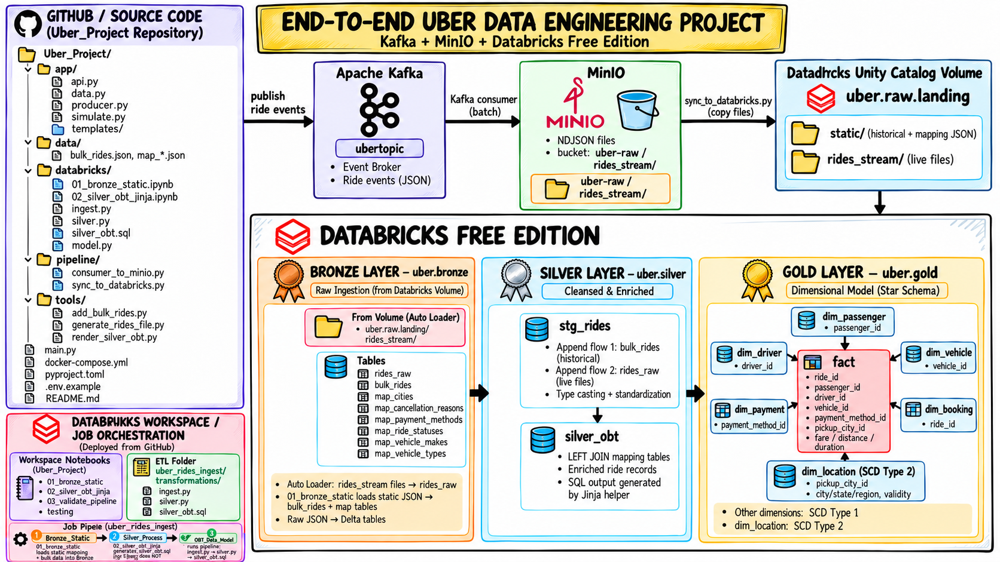

<h1 align="center">
  🚕
  
  End-to-End Uber Data Engineering Project
</h1>

### Kafka · MinIO · Databricks Free Edition · PySpark · Delta Lake


**A practical, end-to-end data engineering pipeline for ride-booking events, historical data, and analytics-ready dimensional models.**

</div>

---

## 📌 Table of Contents

- [Project Overview](#-project-overview)
- [Architecture](#-architecture)
- [Tech Stack](#-tech-stack)
- [Data Flow](#-data-flow)
- [Catalog, Schemas, and Tables](#-catalog-schemas-and-tables)
- [Gold Data Model](#-gold-data-model)
- [Repository and Databricks Workspace Structure](#-repository-and-databricks-workspace-structure)
- [Prerequisites](#-prerequisites)
- [Build and Run the Project](#-build-and-run-the-project)
- [Databricks Job Orchestration](#-databricks-job-orchestration)
- [Optional: Add More Historical Rides](#-optional-add-more-historical-rides)
- [Optional: Test SCD Type 2](#-optional-test-scd-type-2)
- [Day-to-Day Run Loop](#-day-to-day-run-loop)
- [Design Decisions and Limitations](#-design-decisions-and-limitations)
- [Troubleshooting](#-troubleshooting)
- [Author](#-author)

---

## 🎯 Project Overview

This project simulates a ride-booking data platform. A user books a ride through a small FastAPI web app. The app publishes a JSON event to Kafka; a consumer batches the events into newline-delimited JSON (NDJSON) files in MinIO; a sync script moves new files into a Databricks Unity Catalog Volume; and a Databricks pipeline processes the data through Bronze, Silver, and Gold layers.

The project is adapted from the architecture and learning flow of Ansh Lamba's Azure project, replacing the Azure-specific services with a local Kafka + MinIO setup and Databricks Free Edition.

### Business problem

A ride-booking platform needs to combine historical trip records with incoming ride events, standardize the data, enrich records with reference data, and publish reliable analytical tables for reporting. The pipeline demonstrates how to:

- Capture ride events from an application.
- Buffer events and land them as files.
- Ingest live files incrementally using Databricks Auto Loader.
- combine live rides with an initial historical load.
- Enrich rides by joining mapping/reference tables.
- Build Gold dimension and fact tables, including an SCD Type 2 location dimension.

### Project goals

- Practice an end-to-end engineering workflow rather than only isolated transformations.
- Work with Python, SQL, Spark, Delta tables, JSON/NDJSON, event ingestion, and object storage.
- Separate raw ingestion, transformation, and analytical modelling into distinct layers.
- Use CDC-style flows to maintain dimension and fact tables.
- Orchestrate the initial load, SQL generation, and data-model pipeline in Databricks Jobs.

> **Execution note:** Kafka and MinIO run locally through Docker. Databricks Free Edition is the processing environment. Because files are the bridge between the local services and Databricks, this is a **near-real-time micro-batch pipeline**, not continuous end-to-end streaming.

---

## 🏗️ Architecture

<!-- Architecture image location: docs/images/uber-data-engineering-architecture.png. Replace this file to use an updated diagram. -->

<!--  -->

<div align="center">
  
</div>

<details>
<summary><strong>Architecture in text (useful if the image does not load)</strong></summary>

```text
Ride Booking Web App (FastAPI)
          |
          v
Apache Kafka: ubertopic
          |
          v
Kafka Consumer (batch events)
          |
          v
MinIO: uber-raw/rides_stream/*.json (NDJSON)
          |
          v
sync_to_databricks.py
          |
          v
Databricks Unity Catalog Volume: /Volumes/uber/raw/landing/
          |
          +--> rides_stream/ --> Auto Loader --> uber.bronze.rides_raw
          |
          +--> static/ --> 01_bronze_static --> bulk_rides + mapping tables
                                             |
                                             v
                               uber.silver.stg_rides
                                             |
                                             v
                               uber.silver.silver_obt
                                             |
                                             v
                         uber.gold.dim_* + uber.gold.fact
```

</details>

### Technology mapping

| Original Azure-style concept | This project |
|---|---|
| Event Hubs | Apache Kafka in Docker (KRaft mode) |
| ADLS / Blob Storage | MinIO object storage plus a Databricks Unity Catalog Volume |
| Azure Data Factory file transfer | `pipeline/sync_to_databricks.py` or manual file upload |
| Kafka/Event Hubs read inside the processing pipeline | Databricks Auto Loader reading files from the Volume |

---

## 🧰 Tech Stack

<div align="center">
  
  
  
  
  
  
  
  
  
  
</div>

| Area | Technologies and concepts |
|---|---|
| Application and events | Python, FastAPI, JSON ride events |
| Event broker | Apache Kafka, topic `ubertopic`, consumer offsets |
| Object storage | MinIO, bucket `uber-raw`, NDJSON files |
| Local environment | Docker Compose |
| Data platform | Databricks Free Edition, Unity Catalog Volumes |
| Processing and storage | Apache Spark, PySpark Declarative Pipelines, Delta tables, Auto Loader |
| Transformations | SQL, joins, casting, standardization, Jinja2 SQL generation |
| Modelling | Star schema, fact/dimension tables, AUTO CDC, SCD Type 1 and Type 2 |
| Python tooling | `uv`, `python-dotenv`, `confluent-kafka`, MinIO Python SDK, Databricks SDK |

---

## 🔄 Data Flow

### 1. Ride booking and event production

- `app/api.py` serves the FastAPI web app.
- A user books a ride through the app.
- `app/data.py` creates a ride payload, and `app/producer.py` publishes the JSON event to Kafka topic `ubertopic`.
- `app/simulate.py` can generate multiple events for testing.

### 2. Kafka to MinIO

- `pipeline/consumer_to_minio.py` subscribes to `ubertopic`.
- The consumer buffers events and writes NDJSON files to bucket `uber-raw`, under `rides_stream/`.
- The default batch settings write when either 50 messages are buffered or 20 seconds have passed.
- Consumer offsets are committed after an upload succeeds.

### 3. MinIO to Databricks Volume

- `pipeline/sync_to_databricks.py` copies new files into the Unity Catalog Volume.
- The sync script records already-sent files in `.synced.json` to avoid repeatedly uploading the same objects.
- The target is `/Volumes/uber/raw/landing/`, with `static/` and `rides_stream/` folders.
- The sync can run once or poll MinIO in `--watch` mode.

### 4. Bronze: raw and reference data

- The `rides_stream/` files are read incrementally by Auto Loader in `databricks/ingest.py` into `uber.bronze.rides_raw`.
- `databricks/01_bronze_static.ipynb` loads `bulk_rides.json` and the `map_*.json` files into Bronze tables.
- The mapping tables provide ride status, payment method, city, vehicle, and cancellation reason reference values.

### 5. Silver: unify and enrich the rides

- `databricks/silver.py` creates `uber.silver.stg_rides` and defines two append flows: historical `bulk_rides` and live `rides_raw`.
- The flow parses JSON from the `rides` column, casts timestamps, and standardizes the input shape.
- `databricks/silver_obt.sql` creates `uber.silver.silver_obt` by left-joining the ride stream to mapping/reference tables.
- The Databricks workspace notebook `02_silver_obt_jinja` generates the SQL file using Jinja2; the pipeline itself reads the rendered SQL and does not execute Jinja templates directly.

### 6. Gold: dimensional model

- `databricks/model.py` builds six dimension tables and one fact table.
- AUTO CDC flows use business/entity identifiers as keys and timestamps for sequence ordering.
- `dim_location` uses SCD Type 2; the other dimensions and `fact` use SCD Type 1 in the current implementation.

---

## 🗂️ Catalog, Schemas, and Tables

The Unity Catalog is `uber`; all pipeline table names are fully qualified in the code.

| Schema | Object | Purpose |
|---|---|---|
| `uber.raw` | Volume `landing` | File landing area only; contains `static/` and `rides_stream/` |
| `uber.bronze` | `rides_raw` | Raw ride-event JSON delivered from the streaming-file path |
| `uber.bronze` | `bulk_rides` | Historical ride records loaded from `bulk_rides.json` |
| `uber.bronze` | `map_cities` | City, state, region, and update timestamp reference data |
| `uber.bronze` | `map_cancellation_reasons` | Cancellation-reason reference data |
| `uber.bronze` | `map_payment_methods` | Payment-method attributes |
| `uber.bronze` | `map_ride_statuses` | Ride-status reference values |
| `uber.bronze` | `map_vehicle_makes` | Vehicle-make reference data |
| `uber.bronze` | `map_vehicle_types` | Vehicle-type descriptions and fare rates |
| `uber.silver` | `stg_rides` | Unified historical and live ride records |
| `uber.silver` | `silver_obt` | Enriched One Big Table built from rides plus mapping tables |
| `uber.gold` | `dim_passenger` | Passenger attributes |
| `uber.gold` | `dim_driver` | Driver attributes |
| `uber.gold` | `dim_vehicle` | Vehicle attributes |
| `uber.gold` | `dim_payment` | Payment-method attributes |
| `uber.gold` | `dim_booking` | Ride/booking and pickup/drop-off attributes |
| `uber.gold` | `dim_location` | Pickup-city attributes with SCD Type 2 history |
| `uber.gold` | `fact` | Ride-level measures and entity identifiers |

### Bronze ingestion detail

The landing Volume is not itself a Bronze table. It holds the source files. Auto Loader creates `uber.bronze.rides_raw` from live files, while the static notebook creates the historical and mapping tables directly in `uber.bronze`.

---

## ⭐ Gold Data Model

The Gold layer contains **one fact table and six dimension tables**:

| Table | CDC key in current code | Purpose / selected attributes |
|---|---|---|
| `dim_passenger` | `passenger_id` | Passenger name, email, and phone |
| `dim_driver` | `driver_id` | Driver name, rating, phone, and license |
| `dim_vehicle` | `vehicle_id` | Make, type, model, color, and license plate |
| `dim_payment` | `payment_method_id` | Payment method, card flag, and authorization requirement |
| `dim_booking` | `ride_id` | Confirmation, pickup/drop-off details, timestamps, and ride status |
| `dim_location` | `pickup_city_id` | Pickup city/state/region attributes with SCD Type 2 history |
| `fact` | `ride_id` | Ride identifiers, distance, duration, fares, surge, tip, rating, and derived rate attributes |

**Key naming clarification:** the current implementation uses the listed business/entity IDs as AUTO CDC keys. It does **not** generate separate surrogate-key columns such as `passenger_sk` or `driver_sk`. The name of the fact table is `fact` (not `fact_ride`).

### SCD strategy

- **SCD Type 1:** `dim_passenger`, `dim_driver`, `dim_vehicle`, `dim_payment`, `dim_booking`, and `fact`.
- **SCD Type 2:** `dim_location`, keyed by `pickup_city_id` and sequenced by `city_updated_at`.

---

## 🗂️ Repository and Databricks Workspace Structure

This project has **two related folder layouts** that serve different purposes:

1. **The local/GitHub repository** contains the source files you version-control from VS Code.
2. **The Databricks Workspace** contains the notebooks used by your Job and the deployed ETL files consumed by the Databricks pipeline.

They are related, but they are **not one physical folder tree**. A file under `databricks/` in the repository may be deployed/copied to `uber_rides_ingest/transformations/` in the Databricks Workspace.

### A. Local project / GitHub repository

```text
Uber_Project/
├── app/
│   ├── templates/
│   │   ├── home.html
│   │   └── confirmation.html
│   ├── api.py                    # FastAPI ride-booking web app
│   ├── data.py                   # Creates the ride payload
│   ├── producer.py               # Publishes ride events to Kafka
│   └── simulate.py               # Generates test ride events
├── data/
│   ├── bulk_rides.json           # Historical ride records
│   ├── map_cancellation_reasons.json
│   ├── map_cities.json
│   ├── map_payment_methods.json
│   ├── map_ride_statuses.json
│   ├── map_vehicle_makes.json
│   └── map_vehicle_types.json
├── databricks/
│   ├── 01_bronze_static.ipynb    # Job notebook: historical rides + mapping data
│   ├── 02_silver_obt_jinja.ipynb # Job notebook: renders Silver OBT SQL with Jinja
│   ├── ingest.py                 # Auto Loader: Volume files -> bronze.rides_raw
│   ├── silver.py                 # Historical + live append flows -> silver.stg_rides
│   ├── silver_obt.sql            # Mapping joins -> silver.silver_obt
│   └── model.py                  # Gold dimensions + fact table
├── pipeline/
│   ├── .synced.json              # Tracks objects already copied to the Volume
│   ├── consumer_to_minio.py      # Kafka -> MinIO NDJSON files
│   └── sync_to_databricks.py     # MinIO files -> Unity Catalog Volume
├── tools/
│   ├── add_bulk_rides.py         # Adds synthetic historical rides
│   ├── generate_rides_file.py   # Generates ride files for testing
│   └── render_silver_obt.py      # Local Jinja SQL-rendering helper
├── docs/
│   └── images/
│       └── uber-data-engineering-architecture.png
├── .env.example                 # Safe configuration template; no real secrets
├── .gitignore
├── .python-version
├── docker-compose.yml           # Local Kafka + MinIO services
├── main.py
├── pyproject.toml
├── uv.lock
└── README.md
```

> **Git status note:** In your VS Code screenshot, `01_bronze_static.ipynb` and `02_silver_obt_jinja.ipynb` have a `U` marker. In VS Code's Git decorations, `U` means **untracked**. They exist in your local working tree but will not appear on GitHub until you stage, commit, and push them. The tree above describes the intended repository after you add those notebooks. From the repository root, run:
>
> ```bash
> git add databricks/01_bronze_static.ipynb databricks/02_silver_obt_jinja.ipynb
> git commit -m "Add Databricks job notebooks"
> git push
> ```
>
> Do not commit `.env`, `.venv/`, or access tokens.

### B. Databricks Workspace notebooks and Job folder

Your screenshot shows the workspace folder under `Workspace → Users → <your-workspace-user> → Uber_Project`:

```text
Workspace/
└── Users/<your-workspace-user>/Uber_Project/
    ├── 01_bronze_static             # Notebook / Job task: load static Bronze data
    ├── 02_silver_obt_jinja          # Notebook / Job task: render Silver OBT SQL
    ├── 03_validate_pipeline         # Validation notebook
    ├── testing                      # Test / development notebook
    └── uber_rides_ingest/           # Databricks pipeline workspace folder
        └── transformations/         # ETL files read by the pipeline
            ├── ingest.py
            ├── silver.py
            ├── silver_obt.sql
            └── model.py
```

The `transformations/` directory is the **deployed ETL layer** for your Databricks pipeline. It contains the four transformations in execution order:

| Workspace ETL file | Responsibility | Main output |
|---|---|---|
| `transformations/ingest.py` | Auto Loader reads incoming NDJSON files from the Unity Catalog Volume | `uber.bronze.rides_raw` |
| `transformations/silver.py` | Appends the historical `bulk_rides` and live `rides_raw` flows, then standardizes the ride records | `uber.silver.stg_rides` |
| `transformations/silver_obt.sql` | Left-joins ride records to the mapping/reference tables | `uber.silver.silver_obt` |
| `transformations/model.py` | Builds the CDC-driven Gold dimensional model | `uber.gold.dim_*` and `uber.gold.fact` |

### C. How the notebooks, ETL folder, and data layers fit together

```text
Databricks Job
  ├── Task 1: Bronze_Static
  │     └── 01_bronze_static
  │           └── Loads static mapping JSON + historical bulk rides into Bronze
  │
  ├── Task 2: Silver_Process (depends on Task 1)
  │     └── 02_silver_obt_jinja
  │           └── Renders/generates transformations/silver_obt.sql
  │
  └── Task 3: OBT_Data_Model (depends on Task 2)
        └── Pipeline: uber_rides_ingest
              └── transformations/
                    ├── ingest.py       -> uber.bronze.rides_raw
                    ├── silver.py       -> uber.silver.stg_rides
                    ├── silver_obt.sql  -> uber.silver.silver_obt
                    └── model.py        -> uber.gold.dim_* + uber.gold.fact
```

**Important distinction:** `01_bronze_static.ipynb` loads static/historical data into Bronze. `02_silver_obt_jinja.ipynb` does **not** load Bronze data; it prepares the Silver SQL file. The actual file-based ETL pipeline executes the generated SQL along with the Python transformation files.

Keep the repository copies and Workspace `transformations/` copies in sync when you change pipeline logic. The Databricks Workspace path can vary with your account and workspace, so `<your-workspace-user>` is a placeholder rather than a literal folder name.

---

## ✅ Prerequisites

- Python **3.12 or later** (the project declares `requires-python = ">=3.12"`).
- [`uv`](https://docs.astral.sh/uv/) for Python dependency and virtual-environment management.
- Docker Desktop with Docker Compose.
- A Databricks Free Edition workspace with Unity Catalog / Volumes and pipeline/Jobs access required by your workspace.
- A Databricks access token only if you use the automated sync script or workspace REST API upload paths; manual Volume uploads are an alternative.
- Git (recommended for version control).

> Local Kafka and MinIO run in Docker. Configure `.env` with your own local credentials and Databricks workspace details where needed. Do not commit `.env` or access tokens.

---

## 🚀 Build and Run the Project

Follow the phases in order. Confirm each check before moving on.

### Phase 0 — Project setup

From the repository root:

```bash
uv sync
```

Copy the example configuration to `.env`.

**Windows PowerShell:**

```powershell
Copy-Item .env.example .env
```

**macOS/Linux:**

```bash
cp .env.example .env
```

Check that the core Python packages import:

```bash
uv run python -c "import confluent_kafka, minio, fastapi"
```

The command should finish without an import error.

### Phase 1 — Start Kafka and MinIO

```bash
docker compose up -d
docker ps
```

Confirm that the `kafka` and `minio` containers are running.

- MinIO console: <http://localhost:9001>
- Default local development credentials in `docker-compose.yml`: `minioadmin` / `minioadmin`
- Kafka bootstrap address used by the app: `localhost:9092`

These credentials are only for local development. Change them before using this setup beyond a local learning environment.

### Phase 2 — Run the FastAPI app and publish ride events

Start the web app:

```bash
uv run python app/api.py
```

Open <http://localhost:8000> and click **Book a Ride**. The app generates a ride payload, publishes it to Kafka, and displays a confirmation.

To produce multiple rides automatically, use another terminal:

```bash
uv run python app/simulate.py --n 200 --delay 0.2
```

Arguments:

- `--n`: number of ride events to send.
- `--delay`: seconds between events. Use `0` for no intentional delay.

Optional Kafka verification from a terminal:

```bash
docker exec kafka /opt/kafka/bin/kafka-console-consumer.sh \
  --bootstrap-server localhost:9092 \
  --topic ubertopic --from-beginning --max-messages 1
```

Expected result: a JSON ride event.

### Phase 3 — Start the Kafka-to-MinIO consumer

In another terminal, start the consumer and leave it running:

```bash
uv run python pipeline/consumer_to_minio.py
```

The consumer creates the `uber-raw` bucket if it does not already exist, then writes NDJSON objects under `rides_stream/`. Verify the files in the MinIO console. Press `Ctrl+C` to flush the final buffered batch before the process exits.

### Phase 4 — Create the Databricks catalog, Volume, and static Bronze data

Use the `databricks/01_bronze_static.ipynb` notebook in your current project, or open the corresponding `01_bronze_static` notebook in Databricks Workspace. It loads `bulk_rides.json` and the mapping JSON files into Bronze.

1. Run the first two setup cells. They create the `uber` catalog, `raw`, `bronze`, `silver`, and `gold` schemas, the `uber.raw.landing` Volume, and the `static/` and `rides_stream/` folders.
2. Upload the `data/*.json` files to `/Volumes/uber/raw/landing/static/`. Choose one method:
   - **Notebook download:** push the project to a public GitHub repository and set `GITHUB_RAW_BASE` in the notebook's optional download cell to `https://raw.githubusercontent.com/<your-user>/<your-repo>/main/data`.
   - **Sync script:** configure the `DATABRICKS_*` values in `.env`, then run `uv run python pipeline/sync_to_databricks.py --static`.
   - **Manual upload:** in Databricks Catalog, open `uber` → `raw` → `landing` → `static` and upload the JSON files.
3. Run the remaining notebook cells. It creates the six `map_*` tables and historical `bulk_rides` table in `uber.bronze`.

**Check:**

```sql
SELECT count(*) FROM uber.bronze.bulk_rides;
```

The bundled dataset is intended to load **2,000 historical rides** on its initial load.

### Phase 5 — Sync live files from MinIO into the Volume

Before running the automated sync, fill these values in `.env`:

```dotenv
DATABRICKS_HOST=https://<your-workspace>.cloud.databricks.com
DATABRICKS_TOKEN=<your-personal-access-token>
UC_CATALOG=uber
UC_SCHEMA=raw
UC_VOLUME=landing
```

Create or retrieve an access token using your workspace's supported settings. If token creation is unavailable, manually upload the files from MinIO into the Volume's `rides_stream/` folder.

Run once:

```bash
uv run python pipeline/sync_to_databricks.py
```

Or continuously watch for new MinIO objects:

```bash
uv run python pipeline/sync_to_databricks.py --watch
uv run python pipeline/sync_to_databricks.py --watch --interval 10
```

The default watch interval is 30 seconds. Stop the watcher with `Ctrl+C`.

**Check:** the Volume `uber.raw.landing` contains files in `rides_stream/`. Make sure at least one file exists before the first pipeline run; otherwise Auto Loader has no live file to process.

### Phase 6 — Create and run the Databricks ETL pipeline

Add these four source files to the Databricks pipeline in the order of the data flow:

| Order | Source file | Output |
|---:|---|---|
| 1 | `databricks/ingest.py` | `uber.bronze.rides_raw` — Auto Loader reads live NDJSON files as text rows |
| 2 | `databricks/silver.py` | `uber.silver.stg_rides` — appends historical and live rides |
| 3 | `databricks/silver_obt.sql` | `uber.silver.silver_obt` — joins ride records with mapping tables |
| 4 | `databricks/model.py` | `uber.gold.dim_*` and `uber.gold.fact` — AUTO CDC dimensional model |

Run the pipeline. If the UI requests a default catalog/schema, choose `uber` and `bronze`; each dataset name is fully qualified in code.

**Validation queries:**

```sql
SELECT count(*) FROM uber.bronze.rides_raw;
SELECT count(*) FROM uber.silver.stg_rides;
SELECT * FROM uber.silver.silver_obt LIMIT 10;
SELECT * FROM uber.gold.fact LIMIT 10;
SELECT * FROM uber.gold.dim_location ORDER BY pickup_city_id;
```

`stg_rides` should contain the historical ride records plus whatever live events have arrived and been processed. The exact count depends on how many rides you have produced and which files the pipeline has processed.

### Phase 6b — Generate `silver_obt.sql` with Jinja2

The project includes two ways to render the Silver OBT SQL. Use only one upload/write path at a time so two tasks do not overwrite the same file unexpectedly.

#### Option A — Databricks notebook (the Job workflow)

Use the `02_silver_obt_jinja` notebook in Databricks Workspace.

1. Review `PROJECT_FOLDER` and `PIPELINE_FOLDER` at the top of the notebook.
2. Review `JINJA_CONFIG`, which defines the mapping-table configuration used by the template.
3. Run the notebook to render the Jinja template and write the resulting SQL to the pipeline's `transformations/silver_obt.sql` location.
4. Run the pipeline after the SQL is generated.

Writing to a Workspace folder from a notebook may depend on workspace permissions and Free Edition behaviour. If the write step fails, use the rendered SQL printed by the notebook and paste it into `databricks/silver_obt.sql` or the pipeline's SQL file.

If Jinja2 is missing from the notebook environment, install it in a notebook cell where package installation is allowed:

```python
%pip install jinja2
```

#### Option B — Render locally

Run the local helper:

```bash
uv run python tools/render_silver_obt.py
```

This rewrites `databricks/silver_obt.sql` locally. To also upload the SQL into the configured Databricks pipeline folder:

```bash
uv run python tools/render_silver_obt.py --upload
```

The upload mode requires `DATABRICKS_HOST` and `DATABRICKS_TOKEN` in `.env`. It uses the plain-file import format; the uploaded object should be a `FILE`, not a notebook. Default folder names are `Uber_Project` and `uber_rides_ingest`; use `--project-folder` and `--pipeline-folder` to override them.

The generated SQL should represent the same transformation as the hand-written `databricks/silver_obt.sql`. Jinja rendering is a preparation step; the pipeline runs the finished SQL file, not the Jinja template itself.

### Phase 7 — Orchestrate with Databricks Jobs

Create a Job in **Jobs & Pipelines → Create → Job** with these tasks and dependencies:

| Task | Type | Action | Dependency |
|---|---|---|---|
| `Bronze_Static` | Notebook | Run `01_bronze_static` to load the static mappings and historical rides | None |
| `Silver_Process` | Notebook | Run `02_silver_obt_jinja` to render/generate `silver_obt.sql` | Depends on `Bronze_Static` |
| `OBT_Data_Model` | Pipeline | Run the pipeline containing `ingest.py`, `silver.py`, `silver_obt.sql`, and `model.py` | Depends on `Silver_Process` |

Before scheduling the Job, remove the final temporary test cell (`SELECT * FROM uber.bronze.rides_raw`) from notebook `01_bronze_static` if it is present.

The local web app, Kafka consumer, and MinIO-to-Databricks sync watcher run outside this Databricks Job on your machine. The Databricks Job orchestrates the notebook and pipeline tasks only.

---

## ➕ Optional: Add More Historical Rides

Notebook `01_bronze_static` is designed not to reload the historical table from scratch every time. On later runs, it can merge new ride IDs into `uber.bronze.bulk_rides` while leaving existing rides unchanged.

1. Append new synthetic records to the JSON file:

   ```bash
   uv run python tools/add_bulk_rides.py --n 100
   ```

2. Commit and push the updated `data/bulk_rides.json` to your GitHub repository if your notebook loads static files from GitHub.
3. Run the Databricks Job.

The expected historical count would move from 2,000 to 2,100 after adding 100 new unique rides, excluding any live ride events. This incremental-history path is noted as a learning workflow; validate it in your workspace before depending on it operationally. If the streaming source reports unsupported updates/deletes, the README's prior workaround is to review the bulk read in `silver.py` and consider `skipChangeCommits` where appropriate.

---

## 🕰️ Optional: Test SCD Type 2

The SCD Type 2 example is implemented in `uber.gold.dim_location`. It creates a new location version when an incoming ride is processed with a newer `city_updated_at` value for the same `pickup_city_id`.

### Kafka-based test

1. Edit `data/map_cities.json`. For city ID `7`, change `region` and set a newer `updated_at`, for example `2025-06-01T00:00:00` (use a value later than the current one in your data).
2. Commit and push the mapping file if the notebook downloads static files from GitHub.
3. Start Docker, the Kafka-to-MinIO consumer, and the sync watcher (Phases 1, 3, and 5).
4. Generate rides for city 7 so the test event definitely uses the changed city:

   ```bash
   uv run python app/simulate.py --n 10 --city 7 --delay 0.1
   ```

5. Wait for a new file to appear in the Databricks Volume, then run the Job. Notebook 01 reloads the static map, notebook 02 renders the Silver SQL, and the pipeline processes the ride data.
6. Inspect the history:

   ```sql
   SELECT pickup_city_id, pickup_city, region, city_updated_at, __START_AT, __END_AT
   FROM uber.gold.dim_location
   WHERE pickup_city_id = 7
   ORDER BY __START_AT;
   ```

Expected result: the previous version has a populated `__END_AT`; the current version has `__END_AT` set to `NULL`.

**Important:** simply changing the mapping file is not enough. The updated mapping must be applied and a new ride for that city must pass through the pipeline. A full refresh can rebuild the target and lose the history demonstrated by this incremental test; use a normal pipeline run when validating SCD2.

### No-Docker alternative

The helper can write generated rides directly into the Volume, if configured for upload:

```bash
uv run python tools/generate_rides_file.py --n 10 --city 7 --upload
```

This route requires the Databricks token in `.env` and bypasses Kafka and MinIO for the test.

---

## 🔁 Day-to-Day Run Loop

After initial setup, keep these processes running as needed:

| Terminal / service | Command / action | Purpose |
|---|---|---|
| Docker | `docker compose up -d` | Keeps Kafka and MinIO running |
| Terminal 1 | `uv run python app/api.py` | Opens the ride-booking web app |
| Terminal 2 | `uv run python pipeline/consumer_to_minio.py` | Converts Kafka events to MinIO NDJSON batches |
| Terminal 3 | `uv run python pipeline/sync_to_databricks.py --watch` | Copies newly created MinIO files into the Volume |
| Databricks | Run the ETL pipeline or scheduled Job | Moves processed data through Bronze, Silver, and Gold |

For near-real-time ingestion, book rides while the consumer and sync watcher are running. With default batching and polling, the files may arrive in the Volume around a minute later, but the tables update only after the Databricks pipeline processes them.

---

## 🧠 Design Decisions and Limitations

- **Auto Loader instead of direct Kafka access in Databricks:** Kafka runs locally; Databricks reads files from a Unity Catalog Volume.
- **MinIO as local object storage:** it provides an S3-compatible landing area without needing a paid cloud storage account for the local ingestion components.
- **Historical and live flow alignment:** the historical `bulk_rides` and parsed `rides_raw` flows append to the same `stg_rides` streaming table.
- **Explicit schema names:** the code uses fully qualified table names such as `uber.silver.stg_rides` to make targets clear.
- **SCD2 timestamp sequencing:** `dim_location` sequences changes by `city_updated_at`, not by ride ID.
- **Entity IDs, not generated surrogate keys:** the current model uses the entity/business IDs shown in the Gold table definitions as CDC keys; it does not create separate `_sk` fields.
- **Micro-batch file bridge:** events travel Kafka → MinIO NDJSON → Databricks Volume → Auto Loader. It is near-real-time, not true continuous streaming end to end.
- **External job boundary:** the Databricks Job runs notebooks/pipeline tasks; local Docker containers and the sync watcher must be running separately for new live events to arrive.
- **Free Edition caveats:** workspace folder writes, token availability, and some pipeline behaviours may vary. Manual uploads and pasting generated SQL are documented fallbacks.

### Differences from the original Azure-oriented project

- `ingest.py` uses Auto Loader on Volume files instead of reading Event Hubs directly.
- `map_cities.json` includes an `updated_at` field needed to demonstrate SCD Type 2; a city name spelling issue was also corrected.
- `model.py` sequences CDC by timestamps; `dim_location` is maintained as SCD Type 2.
- `bulk_rides` uses an explicit schema so historical and live append flows use consistent column types.
- The original synthetic ride generator is adapted to remove the Azure-specific import.

---

## 🛠️ Troubleshooting

| Problem | What to check |
|---|---|
| Kafka or MinIO does not start | Run `docker ps`, inspect logs with `docker compose logs kafka` or `docker compose logs minio`, and check port conflicts on `9092`, `9000`, and `9001`. |
| No NDJSON files in MinIO | Confirm the app published to `ubertopic`, and that `consumer_to_minio.py` is running with matching `.env` settings. |
| No files in the Databricks Volume | Check `.env` host/token/catalog/schema/volume settings, or manually upload the files. Review the sync script output. |
| `rides_raw` stays empty | Confirm new files exist under `/Volumes/uber/raw/landing/rides_stream/`, then run the pipeline and inspect Auto Loader errors. |
| Silver table is empty | Confirm Bronze has historical rows or live `rides_raw` events; run the pipeline and inspect the event JSON/schema. |
| `silver_obt.sql` is outdated | Run the Databricks Jinja notebook or `uv run python tools/render_silver_obt.py`, then confirm the pipeline points at the updated SQL file. |
| Jinja notebook cannot write a workspace file | Check workspace path and permissions. Use the rendered SQL output and paste/import the SQL manually as a fallback. |
| SCD2 does not show a new version | Ensure `updated_at` is newer, the map update is loaded, a new ride for the same city was processed, and the pipeline was run incrementally rather than as a full refresh. |

---

## 👨‍💻 Author

**Kaustav Roy Chowdhury**  
Data Engineering Projects · Python · SQL · PySpark · Databricks

<div align="left">
  <a href="https://github.com/kaustavforge" target="_blank">
    
  </a>
  <a href="https://www.linkedin.com/in/YOUR-LINKEDIN-USERNAME/" target="_blank">
    
  </a>
</div>

> **Before publishing:** replace `YOUR-LINKEDIN-USERNAME` in the LinkedIn link with your actual LinkedIn profile URL. The GitHub profile link is set to `kaustavforge`.

---

<div align="center">

**Built as a hands-on learning project to practise real-world data engineering patterns.**

If this project helps you, consider giving the repository a ⭐.

</div>
